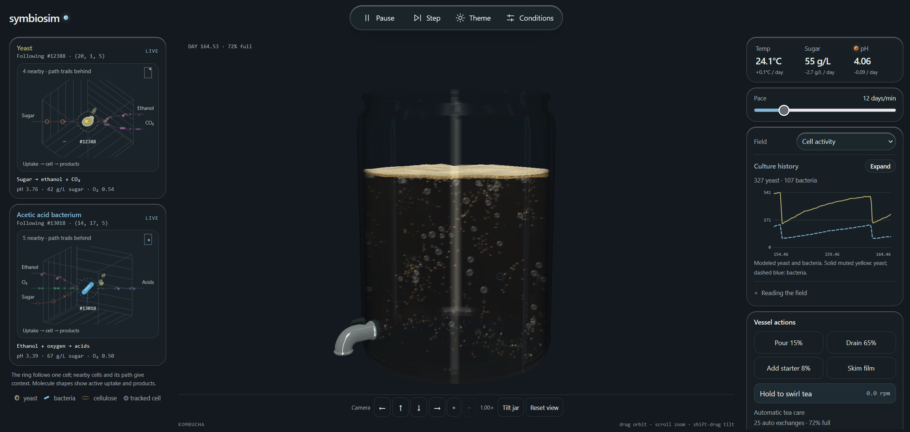

# Symbiosim

A 3D simulation of a kombucha vessel with circulating tea, yeast, acetic acid bacteria, dissolved chemistry, and a floating cellulose pellicle, packaged as a web component.



## Culture

Sweet tea circulates by heat, density, and rising $\text{CO}_2$ bubbles while a **SCOBY** (**s**ymbiotic **c**ulture **o**f **b**acteria and **y**east) ferments sugars into acids and builds a floating cellulose **pellicle**.

| Component | Behavior |
| --- | --- |
| SCOBY | The **s**ymbiotic **c**ulture **o**f **b**acteria and **y**east living throughout the liquid and film. |
| Yeast | Ferments sugars into ethanol and $\text{CO}_2$. |
| Acetic acid bacteria | Consumes oxygen to convert ethanol and glucose into organic acids. |
| Pellicle | Floating cellulose mat formed at the surface by bacterial byproducts; traps gas and thickens over time. |
| Surface mold | Rare aerobic spoiler on warm, low-acid surfaces. |

## Embed

### Hosted iframe

Use the hosted `/embed/` page to keep the simulation code out of the parent site's JavaScript bundle:

```html
<iframe
  src="https://jjjpanda.github.io/symbiosim/embed/?preset=balanced&amp;theme=dark&amp;speed=12&amp;transparent=true"
  title="Interactive fermentation simulation"
  width="420"
  height="520"
  loading="lazy"
  style="border: 0;"
></iframe>
```

The iframe downloads the simulation separately when it loads. The page fills the iframe and always enables `embed` mode. `/embed` redirects to `/embed/`, preserving the query string. The static build includes `embed/index.html`, with relative asset URLs that also work under a project subpath such as `/symbiosim/`.

Query parameters use the same names as the component attributes below:

| Parameter | Accepted values |
| --- | --- |
| `preset` | `balanced`, `convection`, `tangy`, `cool`, `vinegar`, `mold` |
| `theme` | `light`, `dark`; omit for the system preference |
| `field` | Any visualization field listed in Options |
| `speed`, `room`, `swing`, `permeability` | Finite numbers, clamped to their ranges in Options |
| `autoplay` | `true` or `false`; defaults to playing |
| `transparent`, `autofocus` | `true` or a bare parameter enables the attribute; `false` or omission leaves it off |
| `width`, `height` | Positive pixel sizes rounded to whole pixels, constrained to the iframe bounds |

Omit `width` and `height` in the URL to fill the iframe; set the iframe's own dimensions in the parent page. Unknown parameters and invalid values are ignored. For repeated parameters, the first value wins. Presets apply before explicit `room`, `swing`, and `permeability` overrides, regardless of query order. Options are read on page load; changing the iframe URL reloads the simulation. No cross-frame messaging is required.

### Web component

```sh
npm install ../symbiosim
```

```js
import 'symbiosim';
```

```html
<symbiosim-vessel embed transparent width="420" height="520" preset="balanced" theme="dark"></symbiosim-vessel>
```

Adding `embed` hides the masthead, organism close-up rails, instrument panels, HUD, and camera toolbar so only the interactive 3D jar is displayed. Adding `transparent` removes the component backdrop and prevents glass/tea refraction from compositing an opaque room fill behind the vessel.

## Options

Set options with HTML attributes or `setAttribute()`.

| Attribute | Default | Purpose |
| --- | --- | --- |
| `embed` | absent | Show only the 3D jar canvas without surrounding UI panels, HUD, or toolbars. |
| `transparent` | absent | Transparent host background and alpha-preserving glass/liquid refraction. |
| `width`, `height` | automatic | Requested component size in pixels, constrained to `min(100%, <px>)`. |
| `theme` | system | `light` or `dark` (falls back to `prefers-color-scheme`). |
| `preset` | custom | `balanced`, `convection`, `tangy`, `cool`, `vinegar`, or `mold`. |
| `field` | `liquid` | `liquid`, `organisms`, `flow`, `temperature`, `mold`, `sugar`, `oxygen`, `ethanol`, `acidity`, or `co2`. |
| `speed` | `12` | Simulated biological pace in days per minute (`1`–`60`). |
| `room` | `24` | Average room temperature in °C (`15`–`35`). |
| `swing` | `4` | Day/night temperature swing in °C (`0`–`12`). |
| `permeability` | `45` | Gas exchange permeability percentage (`0`–`100`). |
| `autoplay` | on | Set to `false` to start paused. |
| `autofocus` | absent | Focus the component when connected. |

## Controls

Drag the vessel to orbit, scroll or use `+` / `−` to zoom up to 3×, and **Shift-drag** (or toggle **Tilt jar**) to physically tip the vessel and shift gravity. Drag either tracking voxel to rotate its 3D close-up.

| Key | Action |
| --- | --- |
| Space / S | Run or pause / step 0.08 days |
| Hold W | Swirl tea (accelerates rotational momentum while held) |
| H | Pour 8% hot tea at 70°C |
| F / V | Cycle biological speed / visualization field |
| C / E | Open Conditions / Tea recipe & care |
| T / N | Toggle theme / start a new vessel |
| Arrows / R | Orbit camera (`Shift` + arrows tips jar) / reset view |

## Development

Requires Node 22 or newer and WebGL 2. No runtime packages are required.

```sh
npm run dev
npm test
npm run build
```

`npm run benchmark` times solver steps, `npm run soak -- 30 --playback` verifies multi-week culture stability and snapshot restoration, and `npm run check:browser` runs headless Chromium WebGL and layout checks.

After building, `npm run check:browser -- dist --embed` checks the hosted embed page, including its redirect, query options, transparent layout, and WebGL rendering.
